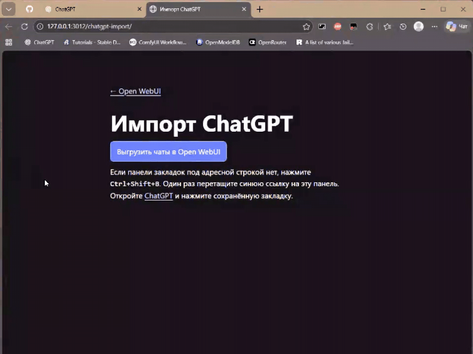

# Импорт ChatGPT через браузер

Если панели закладок под адресной строкой нет, нажмите **Ctrl+Shift+B**. На странице `/chatgpt-import/` один раз перетащите синюю ссылку **Выгрузить чаты в Open WebUI** на эту панель. Ссылка **ChatGPT** открывает сайт в текущей вкладке.

1. Войдите в ChatGPT и Open WebUI в одном браузере. На вкладке `chatgpt.com` нажмите закладку **Выгрузить чаты в Open WebUI**.
2. Дождитесь окончания выгрузки во вкладке ChatGPT и нажмите **Открыть вкладку импорта**. Данные передаются в памяти браузера.
3. Один раз нажмите **Импортировать**. Сервис отправит части автоматически. Если связь прервётся, нажмите **Импортировать** в той же вкладке, чтобы продолжить с неподтверждённой части.

С началом импорта в истории Open WebUI появится отдельный чат **Журнал миграции ChatGPT**. Его текст можно скопировать и отправить администратору. Если выгрузка завершилась без чатов, на странице импорта будет кнопка **Сохранить журнал**.

Экспортёр автоматически получает сводку памяти и пользовательские инструкции из текущей сессии ChatGPT. Каждый раздел сводки импортируется отдельной записью в **Сводку памяти**. Пользовательские инструкции импортируются в **Пользовательские предпочтения**. Для этого у пользователя должен быть доступ к памяти Open WebUI. Если ChatGPT не вернул сводку или инструкции, это будет указано в результате импорта.

Если закладка была сохранена до обновления, замените её новой ссылкой с этой страницы.

Страница использует текущую сессию Open WebUI. Ключ API, UUID пользователя и команды для загрузки не нужны. При повторной отправке ZIP ранее импортированные беседы сверяются с сервером. Изменившиеся беседы отмечаются в отчёте и пропускаются.

## Развёртывание

[Готовый запуск для Windows и пакет для Linux](README.md#развёртывание).

Вложения с подтверждённой связью прикрепляются к сообщениям. Проекты из экспорта создаются как приватные папки. Импортёр проверяет и разбирает ZIP в памяти до записи чатов. Журнал идентификаторов сохраняется для повторных запусков.

Самостоятельная приёмка включает сверку чатов и вложений и повторный импорт того же файла. Убедитесь, что повторный импорт не добавил копии чатов.
